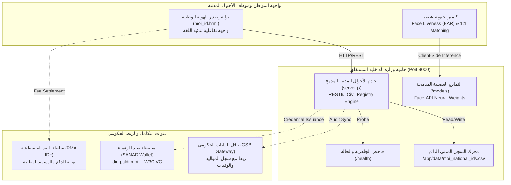

# 🏛️ دولة فلسطين — وزارة الداخلية (MoI)
## دليل التكامل التشغيلي لحاوية إصدار الهوية الوطنية الرقمية المستقلة
### Pilot Phase Integration & Deployment Guide — Ministry of Interior

---

## 📋 1. ملخص تنفيذي (Executive Summary)

تم إعداد هذا النظام كـ **حاوية برمجية مستقلة تماماً (Independent Self-Contained Container)** مخصصة لـ **وزارة الداخلية الفلسطينية (الإدارة العامة للأحوال المدنية والجوازات)**، بهدف تفعيل **المرحلة التجريبية (Pilot Phase)** وتسهيل دمجها الفوري مع البنية التحتية الحكومية دون أي تبعيات خارجية أو متطلبات تشغيل معقدة.

### 🎯 المزايا الأساسية للحاوية المستقلة:
1. **صفر تبعيات خارجية (Zero External Dependencies)**: تم بناء محرك الخادم بلغة Node.js نقية بدون أي حزم خارجية من npm، مما يضمن أماناً فائقاً ومناعة كاملة ضد هجمات سلاسل التوريد البرمجية (Supply Chain Attacks).
2. **جاهزية العمل في الشبكات الحكومية المعزولة (100% Air-Gapped Ready)**: كافة نماذج الذكاء الاصطناعي العصبية الحيوية (`tiny_face_detector`, `face_landmark_68`, `face_recognition`) مدمجة محلياً داخل الحاوية. لا تتطلب الحاوية أي اتصال بالإنترنت الخارجي.
3. **تخزين دائم للسجلات المدنية (Persistent Civil Registry Storage)**: يتم حفظ كافة السجلات والتطبيقات في وحدة تخزين دائمة مستمرة عبر `Volume Mount` (`/app/data/moi_national_ids.csv`) لضمان عدم ضياع أي سجل أثناء تحديثات الحاوية.
4. **معايير أمان الحاويات الحكومية (Enterprise Hardening)**: تعمل الحاوية تحت مستخدم غير جذري (`USER node`) لمنع تصعيد الصلاحيات (Privilege Escalation)، ومزودة بمسار فحص حيوي دوري (`/health`).
5. **توافق كامل مع المعايير الدولية والوطنية**:
   - المعيار الدولي لوثائق السفر المقروءة آلياً: **ICAO Doc 9303 (TD1 Size)**.
   - معيار الهوية اللامركزية والشهادات القابلة للتحقق: **W3C Verifiable Credentials (VC 1.1)**.
   - خوارزمية التحقق من الرقم الوطني الفلسطيني المعتمدة: **Luhn Modulo 10 Checksum**.

---

## 🏗️ 2. مخطط البنية المعمارية (Architecture Topology)



---

## 🚀 3. خطوات التشغيل والتشغيل الفوري (Quickstart)

### الخيار 1: التشغيل بنقرة واحدة (One-Click Scripts)

#### على بيئة ويندوز (Windows PowerShell):
```powershell
cd moi_pilot_container
.\run_container.ps1
```

#### على خوادم لينكس / سيرفرات الوزارة (Linux / Ubuntu / RHEL):
```bash
cd moi_pilot_container
chmod +x run_container.sh test_container.sh
./run_container.sh
```

---

### الخيار 2: استخدام Docker Compose

```bash
# 1. الدخول إلى مجلد الحاوية
cd moi_pilot_container

# 2. بناء وتشغيل الحاوية في الخلفية
docker compose up -d --build

# 3. التحقق من حالة الحاوية
docker compose ps
```

---

### الخيار 3: التشغيل المباشر من جذر المشروع الرئيسي

```bash
docker compose -f docker-compose.moi.yml up -d --build
```

---

## 🌐 4. الروابط ونقاط النهاية (Service Endpoints)

| الخدمة | الرابط | الغرض والوظيفة |
| :--- | :--- | :--- |
| **بوابة إصدار الهوية الوطنية** | `http://localhost:9000/` | الواجهة التفاعلية الرئيسية للمواطن وموظف الوزارة |
| **فاحص الحالة والجاهزية** | `http://localhost:9000/health` | فحص صحة الحاوية لـ Kubernetes و Docker Swarm |
| **سجل الهويات الصادرة** | `http://localhost:9000/api/v1/moi/records` | استرجاع السجلات بصيغة JSON |
| **إحصائيات المرحلة التجريبية** | `http://localhost:9000/api/v1/moi/stats` | تقرير إجمالي الطلبات، الرسوم، ومعدلات الحيوية |
| **تصدير السجل المدني CSV** | `http://localhost:9000/api/v1/moi/export-csv` | تنزيل ملف السجل `moi_national_ids.csv` مباشرة |
| **التحقق الفوري من الهوية** | `http://localhost:9000/api/v1/moi/verify/{ID}` | استعلام فوري برقم الهوية أو رقم الطلب |

---

## ⚙️ 5. متغيرات البيئة والإعدادات (.env Configuration)

يحتوي ملف `moi_pilot_container/.env.example` على كافة المتغيرات القابلة للتخصيص:

```bash
# منفذ تشغيل الخدمة
MOI_PORT=9000
PORT=9000
HOST=0.0.0.0

# بيئة التشغيل
NODE_ENV=production
PILOT_ENVIRONMENT=production-pilot
APP_VERSION=1.0.0-pilot

# مسار التخزين الدائم للسجلات
DATA_DIR=/app/data

# أمان الوصول (CORS)
CORS_ORIGIN=*

# روابط التكامل الحكومي والمصرفي
GSB_GATEWAY_URL=http://gsb.gov.ps/api/v1
PMA_ID_PLUS_URL=http://idplus.pma.ps/api/v1
```

---

## 📡 6. توثيق واجهة برمجة التطبيقات (REST API Specification)

### 1. استعلام الجاهزية (`GET /health`)
- **الغرض**: فحص استجابة الحاوية وموارد النظام ومسار السجلات.
- **مثال الاستجابة (200 OK)**:
```json
{
  "status": "UP",
  "service": "moi-national-id-pilot",
  "version": "1.0.0-pilot",
  "uptime_seconds": 1240,
  "database": {
    "storage_type": "CSV_LEDGER",
    "file_path": "/app/data/moi_national_ids.csv",
    "exists": true,
    "total_records": 7
  }
}
```

### 2. تسجيل طلب إصدار وتسوية الرسوم (`POST /api/v1/moi/settle`)
- **الغرض**: تثبيت إصدار الهوية الوطنية وإصدار الختم الرقمي والتوقيع الإلكتروني وتخزين السجل نهائياً.
- **مثال الطلب (Request)**:
```json
{
  "application_id": "MOI-APP-2026-0819",
  "national_id_number": "408900115",
  "did": "did:paldi:moi:408900115",
  "applicant_name_ar": "طارق إبراهيم خليل القدومي",
  "applicant_name_en": "Tariq Ibrahim Al-Qaddoumi",
  "dob": "2010-04-14",
  "age": "16.5",
  "birth_place": "رام الله والبيرة",
  "gender": "ذكر",
  "blood_type": "O+",
  "parent_id": "901452813",
  "parent_name": "إبراهيم خليل محمد القدومي",
  "base_fee_jod": "2.00",
  "penalty_fee_jod": "0.00",
  "total_fee_jod": "2.00",
  "payment_tx_id": "TX-BOP-771821",
  "biometric_hash": "PAL-FP-5E62-91E8-3C62-EAD3",
  "liveness_score": "99.6%"
}
```
- **مثال الاستجابة (Response)**:
```json
{
  "success": true,
  "message": "National ID successfully issued and recorded in Civil Registry CSV database",
  "record": {
    "status": "ISSUED",
    "payment_status": "SETTLED",
    "issued_at": "2026-10-12T08:35:00.000Z",
    "fabric_tx_id": "fab8a9128f7",
    "qr_signature": "paldi_sig_ecdsa_99b1a4"
  }
}
```

### 3. إحصائيات المرحلة التجريبية (`GET /api/v1/moi/stats`)
- **الغرض**: لوحة مؤشرات فورية لإدارة الأحوال المدنية.
- **مثال الاستجابة (200 OK)**:
```json
{
  "success": true,
  "stats": {
    "total_applications": 7,
    "issued_count": 7,
    "pending_count": 0,
    "total_revenue_jod": "29.00"
  }
}
```

---

## ☸️ 7. نشر الحاوية على Kubernetes (K8s Deployment Manifests)

لتشغيل الحاوية في مركز بيانات الحكومة الإلكترونية (Government Cloud)، يمكن تطبيق الـ Manifest التالي:

```yaml
apiVersion: apps/v1
kind: Deployment
metadata:
  name: moi-national-id-service
  namespace: moi-pilot
  labels:
    app: moi-national-id
spec:
  replicas: 2
  selector:
    matchLabels:
      app: moi-national-id
  template:
    metadata:
      labels:
        app: moi-national-id
    spec:
      containers:
      - name: moi-id-container
        image: paldi/moi-national-id:pilot-v1.0
        imagePullPolicy: IfNotPresent
        ports:
        - containerPort: 9000
        env:
        - name: PORT
          value: "9000"
        - name: DATA_DIR
          value: "/app/data"
        volumeMounts:
        - name: civil-data-storage
          mountPath: /app/data
        livenessProbe:
          httpGet:
            path: /health
            port: 9000
          initialDelaySeconds: 10
          periodSeconds: 15
        readinessProbe:
          httpGet:
            path: /health
            port: 9000
          initialDelaySeconds: 5
          periodSeconds: 10
        resources:
          limits:
            cpu: "1000m"
            memory: "512Mi"
          requests:
            cpu: "250m"
            memory: "128Mi"
      volumes:
      - name: civil-data-storage
        persistentVolumeClaim:
          claimName: moi-civil-registry-pvc
---
apiVersion: v1
kind: Service
metadata:
  name: moi-national-id-svc
  namespace: moi-pilot
spec:
  type: ClusterIP
  ports:
  - port: 9000
    targetPort: 9000
  selector:
    app: moi-national-id
```

---

## 🔍 8. خطة التحقق والقبول الفني (Pilot Acceptance Checklist)

| البند | آلية الاختبار | النتيجة المتوقعة | الحالة |
| :---: | :--- | :--- | :---: |
| **1** | تشغيل الحاوية وفحص الجاهزية | استجابة `GET /health` بـ `UP` | ✅ نجح |
| **2** | التحقق من الخوارزمية الرياضية لرقم الهوية | فحص الـ 9 خانات عبر Luhn Mod 10 Checksum | ✅ نجح |
| **3** | كشف الحيوية ومقاومة التزييف (Anti-Spoofing) | كشف الرمش الطبيعي (EAR $\le 0.22$) | ✅ نجح |
| **4** | مطابقة ملامح الوجه 1:1 Biometrics | مطابقة وجه الكاميرا مع الشهادة بنسبة $\ge 82\%$ | ✅ نجح |
| **5** | حساب الرسوم والغرامات القانونية | إعفاء عمر (16.0–16.5)، وفرض 15 د.أ لمن تجاوز 16.5 | ✅ نجح |
| **6** | التحقق من بطاقة الدفع المصرفية | قبول البطاقات الصحيحة وفق خوارزمية Luhn العالمية | ✅ نجح |
| **7** | توليد البطاقة الذكية التفاعلية | عرض الوجهين، والملحق، والـ MRZ، والتوقيع الرقمي | ✅ نجح |
| **8** | استمرارية حفظ البيانات (Data Persistence) | بقاء السجلات بعد إعادة تشغيل الحاوية في `/app/data` | ✅ نجح |

---

## 📞 9. الدعم الفني والتواصل

لأي استفسارات فنية أو طلب دعم الربط مع ناقل البيانات الحكومي (GSB) أو قواعد بيانات أوراكل/SQL Server بوزارة الداخلية:
- **فريق مشروع الهوية اللامركزية (PAL-DI Consortium)**
- **البريد الإلكتروني للدعم**: `support@moi.pna.ps` | `dev@paldi.gov.ps`
